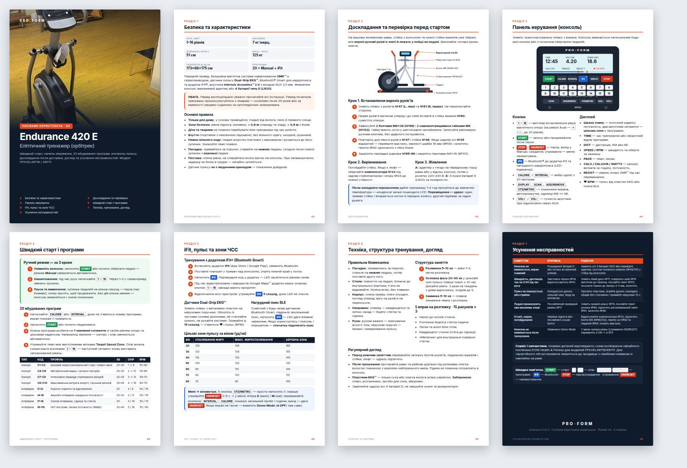

# ProForm Endurance 420 E — інструкція-книжечка A5

Ілюстрований посібник користувача для еліптичного тренажера ProForm Endurance 420 E (PFEVEL49716/49717), зібраний за офіційним мануалом ICON Health & Fitness.

| Файл | Призначення |
| --- | --- |
| `proform-endurance-420e-a5-manual-uk.pdf` | Книжечка A5 (148 × 210 мм), 8 сторінок, українською — для читання з екрана або друку на A5 |
| `proform-endurance-420e-booklet-imposition-uk.pdf` | Спуск полос: 4 аркуші A4 альбомні, по 2 сторінки на сторону. Друк двосторонній (переворот по короткому краю), скласти навпіл, скріпити по згину |
| `proform-endurance-420e-a5-manual-uk.html` | Вихідний HTML/CSS-макет книжечки |
| `proform-endurance-420e-manual-uk.md` | Повний текст посібника українською (Markdown) |
| `proform-endurance-420e-manual.md` | Повний текст посібника російською (Markdown) |
| `preview-uk-pages.png` | Превʼю всіх 8 сторінок |

